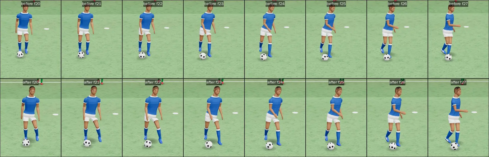
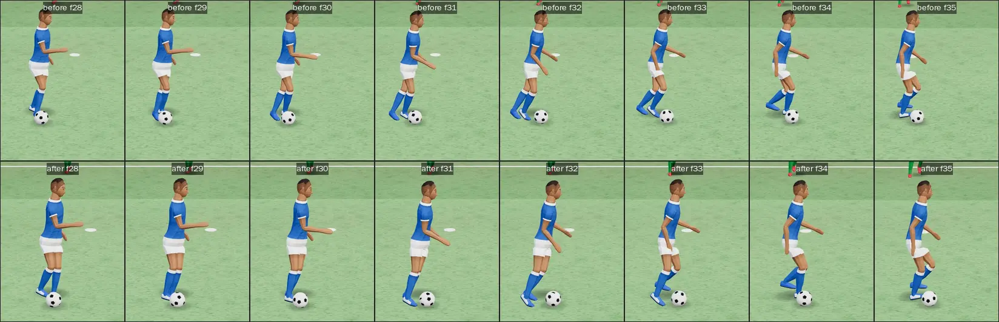

# BCS: the better control system (branch bcs/controls)

The user's words, about the last two frames in the top right of the lead's recording of our player turning:

> here these last two in top right are having broken footing, and inhuman feet placements as the legs cross and go
> through each other

The task built on that. In third person, W A S D move the body relative to the camera, and the body turns to run that
way at any speed. V (the shoulder check) is gone. Close control is automatic. In a big turn the legs no longer cross
or pass through each other.

Base: `6cfac4a` (the FC 27 spec notes). Everything below is on `bcs/controls`.

## 1. Third person: free movement (control.js)

`SET.footCam` is `"third"` (Training, Free Play, the drills, the warm-up, the Full Match) or `"first"`.

**Third person** (`bcsTP()`):

- W A S D give a direction on screen relative to the camera's yaw (`P.yaw`): W is away from the camera, S is towards
  it, A is left, D is right.
- The intent's `face` is `null`, so mover.js turns the facing after the heading. The walk, jog, run and Shift sprint
  are the same in every direction: A held from a stand faces screen-left in 0.12 s, reaches the jog and then the run,
  and A with Shift reaches 8.5 m/s, 95% or more of the sprint.
- The look (`P.yaw`) is never changed by the keys.

**The wish (`CTRL.wish`).** The direction the body is asked to go is a yaw that is smoothed towards the keys' direction:

- It turns at `CURVE_K` × `prm.aLat` × the turn factor / max(v, 0.5), clamped to `CURVE_MIN`..`CURVE_MAX` rad/s.
  That is about 7 rad/s at a run and 4.7 at a full sprint. A second key added is a curve at the clip's rates
  (fc27-spec 3.4), not a 45-degree snap into the mover's cut.
- A change of more than `SNAP` (the keyboard's 135 and 180 degrees) goes straight to the mover, which plants and
  pivots (the cut rule). So does any change below `STAND_V`.
- The wish is reset when no key is held, and in first person.

**From a stand.** The body turns on the spot first (mover.js `turnFirst`) at `TURN_RATE`. On the move, the facing
follows the heading at `FACE_RATE`.

**The facing is held only for:**

- the jockey
- a strike, a pass or a flick being charged or struck: with the ball yours, within `AIM_NEAR` m of it, or with it
  rolling to you; facing the aim, and never in defence
- a fake
- a header's meeting run (facing the look)
- the engine's shield
- a pass about to reach you (the receiving stance): the body opens to the ball when it arrives within `RECV_T` s,
  rolling at `RECV_V` m/s or more, from no further round than `RECV_ANG` off your facing. The control radius
  (zone.js) is widest facing the ball. Without this the tr6-receive pressure drill lost every ball, because the body
  had turned away.

**Other changes:**

- A receive's push takes the raw keys' direction (`p.push`), not the smoothed wish.
- The flick and fake directions are re-read relative to the body in third person (body-relative key quantising).
- The mover parameters are overlaid each step (`bcsPrm`). In third person: `turnFirst` true, `turnFirstRate` 13
  (mover default 7.5), `faceRate` 12. In first person: `turnFirst` false, `faceRate` 12 (the football profile's own).
- **First person is unchanged in behaviour.** The body faces the view, with the strafe cap of 4.0 m/s and the
  backpedal cap of 3.2 m/s.

| Knob (control.js `BCS`) | Value | Was |
|---|---|---|
| CURVE_K, CURVE_MIN, CURVE_MAX | 5, 4, 14 rad/s | (none: the keys snapped) |
| SNAP | 120 degrees | (none) |
| STAND_V | 1.2 m/s | (none) |
| TURN_FIRST, TURN_RATE | true, 13 rad/s | false in football (face held), mover 7.5 |
| FACE_RATE | 12 rad/s | 12 |
| AIM_NEAR | 3 m | (none: face always held) |
| RECV_T, RECV_V, RECV_ANG | 0.7 s, 2 m/s, 110 degrees | (none) |

## 2. V removed

The following are gone: the shoulder check (`CTRL.scan`, `scanStep`, `CN.SCAN_MAX`, `CN.SCAN_BACK`), its call in
controller.js and training.js, its HUD hint and its fphud.js mention. The runner's state digest now keeps `wish` in
place of `scan`.

`KEYS` still lists `v`, so the browser default stays stopped in a match. V does nothing.

The hints no longer list V. On a loose ball near you, the hint now says "W A S D: get to it first to keep it".

## 3. Close control, automatic (actions.js keepStep, sim.js, agent.js)

Each step the player's controls run, they set `a.intent.ctlAuto`. The AI never sets it, and `keepStep` clears it each
step. `sim.js` calls `keepStep` when `a.ctlOn || intent.ctlAuto || intent.knock`.

**When close control is taken.** The ball is gathered with a touch (`ctlTouch(force)`) and `a.ctlOn` is set when all of
these hold:

- The ball is the player's by the race (`ms.poss.ctl === a.id`). This covers a pass received, a loose ball reached
  first, a 50/50 won and a regain. So a ball at a team-mate's or an opponent's feet is never taken.
- The ball is free, below `TAKE.MAX_Y` 0.5 m, and within `AUTO.REACH` 1.2 m.
- Nothing of the player's is under way.
- It is not his own strike within `AUTO.OWN_T` (1 s). His own strike is the kinds in `STRUCK`: shot, pass, through,
  cross, lob, clear, roll, punt, header, throw, kick. The time is remembered in `a.ownT`, because the race's own
  re-touch (after GHOST_T) relabels `ball.last.kind` as 'control'. Another body's touch, or a deflection, clears it.
- It is not within `AUTO.FIRST_T` (0.2 s) of his own first touch, so the first touch's push and quality play out first.

**When close control ends:**

- a tackle or the ball lost ('lost')
- the knock-on: Shift twice ('knock')
- the flick: the middle button ('flick')
- a shot or a pass
- out of play
- out of reach
- the AI standing in for him (`ms.meAI`: a match played out headless, the harness) ('ai'). Close control is the
  player's own. Taken by itself now, it was still on when the AI took over from a player on the ball, and `keepStep`
  went on touching the ball against the AI's own dribble: tr9-anim's MV-9 drill saw 135 touches in 20 s, 25 of them
  with no swing of the legs to draw them. The chase after a knock-on ends with it.

**After a knock-on or a flick** (`a.ctlChase`), he stays out of close control while he chases at a sprint with Shift
held. He is back in once the ball has left his feet (`a.ctlOut`) and he lets go of Shift, or drops below `AUTO.RUN_K`
(0.9) of his run with the ball at his feet. The chase ends at once when play stops or another body plays the ball.

**F** no longer takes the ball. F keeps the slide, the settle, the foot, the cushion, the finesse and the small touch.

**A shield's touches are its own.** While `a.shield.on`, close control stays on but leaves the ball to `shieldStep`.

| Knob | Value | Was |
|---|---|---|
| TAKE | {REACH 1.2, MAX_Y 0.5} | {REACH 1.2, WIN 2, MAX_Y 0.5} (WIN was F's window) |
| AUTO | {REACH 1.2, OWN_T 1, FIRST_T 0.2, RUN_K 0.9} | (new) |

## 4. The legs in a turn (gait.js)

### Reproduced

I captured the user's turn frame by frame in game time: the world stepped 1/60 s at a time and a picture every 1/30 s,
with the camera behind the player and 3.8 m up, as in the lead's capture (a scratch script, not committed; the same
turn is measured by bcs-controls). The turn is a run at the camera (S), then W+D, a turn of 135 to 180 degrees with
the view held on goal. At its worst before the fix:

- the left ankle was 0.150 m right of the right one across the pelvis
- the shins were 0.018 m apart (through each other)

The outside foot came down across in front of the planted one, and its swing went through that leg. A then D at a run
(the reversal) crossed the same way: side −0.155 m, shins 0.029 m.

Frame by frame, before (top, the base) and after (bottom, the final code), frames 20 to 35 of the same turn. Over all
70 frames of the after capture the worst values are: planted twist 0.59 rad, shins 0.117 m apart, the left ankle
0.070 m left of the right, a knee 0.16 rad off its foot, and no planted slip. A foot that looks crossed in a frame
here is a swing passing behind the planted leg, seen from the side.

### What was wrong, and the fix

The guards that keep the feet on their own sides are all in gait.js and all marked (BCS).

1. **A landing across the planted foot** (`sideLand`). Every cycle or stop landing is kept at least `SIDE_LAND` out on
   its own side of the planted foot. It is measured across the way the hips will face as it comes down: the planted
   foot's way, turned on towards the facing by at most `PEL_LT1`.

   A step in place (a turn on the spot) has its own guard, `sidePivot`. It keeps the step `SIDE_PIV` out on its own side
   of the planted foot, across the pelvis as it lands. It only ever moves the step out to its side or on round the
   way the body will face, never back against it. An earlier version used `sideLand` for these steps. It put the first
   step of a life start at 180 degrees 0.18 to 0.20 m back against the way of travel, which tr2-startstop forbids
   (MV-12). A larger `SIDE_PIV` (0.12) brought that back (0.064).
2. **The other foot in the air too** (a run's flight). The first version measured against the other foot's landing,
   which is a stride further on. Across a turning body, a few degrees of error put the landing half a metre out,
   beyond reach, and the foot slid in once down: 43 mm in the user's turn and 21.5 mm in A then D. Now the landing is
   kept `SIDE_AIR` on its own side of the body's own line at touchdown (the root then), across the pelvis as it will
   be (`pelvisYawAt`).
3. **The swing** (`swingAt`). A swinging foot keeps `SIDE_SWING` from the planted foot across the pelvis now.
   Against a swinging other foot, it keeps `SIDE_SWING` while the two pass each other and `SIDE_AIR` once they are a
   stride apart along the pelvis (`SIDE_ALONG`). The reference is the other foot's footprint as it leaves the ground,
   so nothing jumps when it lifts. The guard is eased in over the first 15% of the swing and out over `SIDE_FADE`,
   where the foot comes straight down onto its landing.
4. **The hips turning across a planted leg** (`sideHips`, in pelvisStep). Turning towards a foot planted ahead (the
   inside foot of a turn, or of a reversal's plant), the pelvis swung round past it and the legs crossed. Where
   neither foot can be moved, the pelvis's goal is kept to the yaws that leave the left foot at least `SIDE_PEL` left
   of the right across it. That is when both feet are planted, or one is planted and the other is just off the
   ground or coming down. It is measured foot to foot. Measuring each foot against the hips' centre flung the pelvis
   round as a foot passed under it (tried, 36 degrees the wrong way). It applies while moving, and on the spot while
   the body turns (`G.sideK`). There the root stays put, and the planted foot ends up in front of the hips once the
   body has turned a third of a turn past it.
5. **Half a turn on the spot** (`pivotTarget`, `standStep`). Past 180 degrees the shorter way flips, and a pivot step
   was sent round the wrong side, across the other foot. A turn of about half a turn (|yawRate| > 1, |error| > 2 rad
   against the turn) now goes on the way the body is turning.
6. **A swinging leg turned in** (`TOE_IN`). After a big turn the feet come round a step at a time: 0.35 rad a step
   running, and `LAND_LT` at landing. The knee's pole is the foot's way, so a foot left turned in by 20 to 26 degrees
   brought its shin within 4 to 5 cm of the other one as they passed. While it passes, a swinging foot is turned in
   by at most `TOE_IN` off the pelvis. This is eased in off the ground and out onto the landing, which keeps its yaw.
   It applies only to cycle and stop steps, only when the foot is turned in by less than a quarter turn, and by at most
   `TOE_MAX`. Applied to every step, it turned a step in place (whose feet are well off the pelvis on purpose) through
   most of a half turn, and wrung the thigh round 0.27 to 0.31 rad in a frame (tr2-startstop's life starts at 90 and
   135 degrees).
7. **Only in a turn** (`G.sideK`, `sideK`). The margins of 1 to 3 are in full while the body turns, and for `SIDE_HOLD`
   after. The turn is the larger of the body's own turn rate and its heading's, eased in over `SIDE_TURN`. On a
   straight the margins are `SIDE_FLOOR` of themselves, which is under the gait's own footprints: a run's step is
   0.096 wide and a walk's 0.156. So a walk or a run in a line is drawn exactly as before, whether it is the player's,
   the AI's or a passer-by's in the town. With the full margins on a straight, a run's footprints had been pushed out
   from 0.046 to 0.058 either side of its line.

| Knob (gait.js) | Value |
|---|---|
| SIDE_LAND | 0.15 (body units × scale) |
| SIDE_SWING | 0.14 |
| SIDE_FADE | [0.8, 0.97] of the swing |
| SIDE_AIR | 0.06 |
| SIDE_ALONG | [0.25, 0.6] m |
| SIDE_PEL | 0.06 |
| SIDE_PIV | 0.06 |
| TOE_IN, TOE_MAX | 0.12 rad, 0.5 rad |
| SIDE_TURN | [0.5, 1.5] rad/s |
| SIDE_FLOOR | 0.5 |
| SIDE_HOLD, SIDE_RISE | 0.5 s, 0.15 s (the turn factor's fall and rise) |

All of these are new, so there is no old value.

### After (qa/bcs-controls.mjs, the legs part, game time)

| Run | Planted twist (rad) | Closest shins (m) | Left ankle left of right (m) | Knee off its foot (rad) | Planted slide (mm) |
|---|---|---|---|---|---|
| Straight run (baseline: the gait's own, untouched) | 0.13 | 0.151 | 0.076 | 0.147 | 0 |
| A then D at a run | 0.707 | 0.077 | 0.051 | 0.198 | 8.2 |
| User's turn, with the ball | 0.508 | 0.100 | 0.108 | 0.115 | 1.4 |
| User's turn, without it | 0.508 | 0.100 | 0.023 | 0.202 | 1.29 |
| Turn from a stand | 0.784 | 0.124 | 0.004 | 0.162 | 1.31 |
| **Bound** | ≤ 1.05 | ≥ 0.06 | ≥ 0.02 (≥ 0 from a stand) | ≤ 0.6 | ≤ 12 |

These are the final run's numbers (`qa/out/bcs-controls.json`, at `b5730cf`; the gait has not changed since `e99b56c`,
and the run before gave the same numbers to the last digit).

The largest planted twist measured is 0.784 rad, 45 degrees, in the turn from a stand. In every run the planted foot is
wrung round no further than the 45 to 60 degrees asked for.

The turn from a stand has its side bound at 0, not 0.02. Its first step is a pivot in place (`sidePivot`, `SIDE_PIV`
0.06), which may not be pushed back against the way the body will face (tr2-startstop's MV-12). Its closest is
0.004 m: for a moment, as the body comes round, one foot is nearly in line behind the other across the pelvis. They never
cross. The shins stay 0.124 m apart or more.

Planted slide is the heel, the ball of the foot or the toe tip, whichever moved least, summed over each stance. It is
measured on the drawn skeleton, so a foot turning on its ball does not count.

The knee on a dribble touch's reach is reported apart (`kneeTouch`). It is 0.62 rad in the turn with the ball, where the
FC 27 touch's via point pulls the right foot about 0.5 m out to the side to reach the ball. That is the carrier
package's drawing, not a crossing (see open items).

Along the way, two of my own guards were wrong, and the frames showed it:

- **The other foot's far-off landing.** Measuring against the other foot's landing a stride on moved the landing out
  of reach, and the planted foot slid 43 mm.
- **The hips' centre.** Measuring each foot against the hips' centre flung the pelvis round as a foot passed under it.

Both are replaced as described above.

## 5. Tests

### New: `qa/bcs-controls.mjs` (group `bcs` in qa/run.mjs)

Node part:

- a pass received is in close control after the first touch, with no key
- a tackle ends it ('lost')
- the AI standing in for him (`ms.meAI`) ends it ('ai'), and no close-control touch of his follows
- the player's own pass or shot (soft, 1.6 m/s, still in reach) is never taken back within `AUTO.OWN_T`
- a ball an opponent or a team-mate has at his feet 0.9 m away is never taken

Browser part (real keys under pointer lock, third person, the look held, the world stepped at 1/60 s):

- A, A + Shift, S and W+D give the right ways and speeds
- A then D: the plant and the reversal, and the turn-rate cap
- the legs, as in the table above, with the frames written to `qa/out/bcs-controls-legs.json`
- V does nothing, and the hints are right
- first person is a strafe
- walking onto a loose ball takes close control
- Shift twice: a knock-on, the chase, and back in on letting go
- the middle button: a flick
- no errors

`BCS_PART=legs` (or `move`, `v`, `fp`, `ctl`) runs only that browser part.

### Updated on purpose (they encoded the old controls)

- **u26-keep, u27-control, u28-flick:** the Node intent sets `ctlAuto` as the controls do. They no longer press F.
  The 'lost' check reads one step after the opponent is put on the ball. The step counts are longer for the walk-up.
- **u27-feel, u28-flickfeel, u26-feel:** no F. The chase with Shift held stays out of close control, and letting go
  takes it back.
- **tr2b-shield (section 2), wpF-controls (S8):** V does nothing.
- **uf2-feel (U17 touch part):** "a push touch with W leaves the ball further than the settle" read the ball 36 steps
  on. Close control now gathers it once `AUTO.FIRST_T` has passed, so both balls sat at the close-control spot by then
  (0.56 m against 0.33; base 0.63). It now reads the push from the touch's own distance (td 0.8 against the settle's
  0.44), with the ball still no nearer than the settle's after. "Only a sprint pushes it further ahead" became "a sprint
  in close control keeps it close and yours" (mean lead 0.57 m): close control holds the ball on its spot at every
  pace, and the knock-on (Shift twice) is what plays it on.
- **wpF-controls (S7, receiving):** the ball's rest after the first touch is no longer seen, because close control
  takes it in and keeps it at the feet. The same bounds are now on the touch's own distance (td: 0.54 m at control 30,
  0.42 at 90; with no keys standing and the assists on, the touch is the settle's, 0.38 to 0.68 m, UF2-A, as it was
  before). A third check asks that close control takes the ball in with no key (10 of 10 at both).

## 6. Test results

Run one at a time on QA_PORT 9517, on a machine shared with other sessions (load average 10 to 22 on 4 cores). The
base is a scratch worktree of `6cfac4a`, served on 9518, for every failure that is not ours.

**Passing on the final code** (`b5730cf`, or, for suites the last commits cannot touch, `e99b56c` with the test
changes of `3e55548`):

| Suite | Result |
|---|---|
| unit (31 files) | 31 of 31 pass |
| lint, nodash | pass |
| smoke | pass |
| bcs (`bcs-controls`) | 29 of 29 checks |
| tr2 (13 scripts) | 13 of 13 pass. tr2-halftime 113 of 113 (again at `b5730cf`), tr2-realmatch 9 of 9, tr2-keys 14 of 14, tr2-kickoff 12 of 12, tr2-startstop, tr2-gait, tr2-stop, tr2-clipexit, tr2-gkshuffle, tr2-viewleak, tr2-scale, tr2-passme, tr2-gkme |
| tr8-fullmatch | 30 of 30 (again at `b5730cf`) |
| uf-turn | pass |
| tr2b-shield | 28 of 28 |
| wpF-controls | 17 of 17 (at `b5730cf`, with S7 moved on purpose) |
| uf2-feel | all checks pass (at `b5730cf`) |
| u21-smooth, u21-warmup | pass; 19 of 19 |
| u26-keep, u27-control, u28-shot, u28-flick, tr6-receive | 8 of 8, 11 of 11, 10 of 10, 7 of 7, 12 of 12 |

**Failing, and the same on the base:**

| Suite | On bcs/controls | On the base (`6cfac4a`) |
|---|---|---|
| tr9-anim | 23 of 26. Planted slide 13.957 mm, bone turn 2.051 rad, both in the corner drills (corner-take, corner-box); a transition 1.589 rad | 23 of 26: the same three, with the same corner-drill values (13.957 mm, 2.051 rad) |
| u21-camera | the mouse turn and the pass assist (real pointer-lock mouse moves arrive late) | fails the same checks in 2 of 3 runs (a known environment failure) |
| u27-feel, u28-shotkeys, u29-flickcam, u28-flickfeel, u26-feel | time out in `frames()`: the page's real requestAnimationFrame stops coming (a CDP pause finds the page idle). It is intermittent: the turn capture's own real frames came through between two of these runs | the same: u27-feel timed out at 1200 s, u28-flickfeel at 300 s, at the same `frames()` call |

tr10-perf and tr10-leak were not run (known environment-only budgets).

**Fixed along the way:**

- An earlier tr9-anim run failed two more checks: MV-9 dribble touches (139 in the drills, 114 asked of the legs) and
  one contact of 18 at 0.342 m. Both came from close control left on when the AI took over the player in the
  att-midfield drill. Close control now ends with `ms.meAI` (`b5730cf`), and both pass.
- uf2-feel failed its two U17 checks that encoded the old controls. They were moved on purpose (`2849ae8`, section 5).
  It also failed the throw-in meter in two full runs (the meter came up as a pass). The base failed the same check with
  the same values in one of its two runs, and the final run on bcs/controls passes it.

## 7. Open items

- **The dribble touch's knee** (FC 27 carry, `G.via`). Reaching the ball 0.5 m to the side at 6 m/s after the turn,
  the knee points 0.62 rad (35 degrees) off the foot. The touch's via point moves the ankle, and the knee's pole stays the
  foot's way. This is for the carrier package. bcs-controls reports it as `kneeTouch` and does not fail on it.
- **The first touch and close control.** Close control takes a received ball in `AUTO.FIRST_T` (0.2 s) after the
  first touch when it is within `AUTO.REACH` (1.2 m). A poor first touch (touchDist 1.0 m at a quality of 0.5) is then
  gathered as soon as it is in reach, so Ball Control shows less in where the ball ends up than when F had to be
  pressed. The touch's own distance still follows the rating (wpF-controls S7). If the feel wants more of it,
  `FIRST_T` could grow with a poor touch's quality; that is a tuning call left open.
- The landing guards measure against the planted foot across a predicted pelvis yaw (`sideYaw`), not the pelvis the
  foot will actually have. The bounds hold in every measured turn, but a stranger turn (a cut on a slope, a stumble)
  may still put a foot over the line for a frame or two, eased by the swing guard.

## 8. Notes for the integrator and the turns package

- **gait.js guards for every body.** The guards apply to every body that walks, not only the player. In a line they
  are no-ops, because of `G.sideK` (section 4, point 7): bcs-controls's straight run checks the gait's own footprints
  of 0.046 either side. The shuffle style is left alone (its own landing keeps the sides). `sideHips` runs only while
  moving (`G.state !== "STAND"`), and `TOE_IN` only bites on a foot turned in, which a straight walk or run never has
  (its feet turn out 0.03 to 0.07 rad).
- **Order with FC 27.** `sideLand` runs after `planLanding`, which includes FC 27's `touchLanding` if it is there. An
  override footprint (`G.over`, a strike's run-up or stop) is never moved.
- **The turns package.** The facing in third person is `face: null`, so mover.js turns the body after the heading.
  `CTRL.wish` (control.js) is the smoothed way. A turn package that wants its own step-turn should read
  `CTRL.wish.yaw` against the heading, or the raw keys (the receive push already takes the raw keys, `p.push`). The
  mover parameter overlay is `bcsPrm` (turnFirst, turnFirstRate, faceRate), applied every step from control.js. A
  package that sets those itself must do so after `controlStep`.
- **Close control state.** The fields are `a.ctlOn`, `a.ctlEnd`, `a.ctlChase`, `a.ctlOut` and `a.ownT`. The AI never
  sets `intent.ctlAuto`. `ms.meAI` (autoplay, a match played out headless) keeps the player out of close control and
  ends it if it is on ('ai').
- **Tests.** bcs-controls takes about 10 to 25 minutes under this machine's load. Its legs part alone (`BCS_PART=legs`)
  takes about 8.
